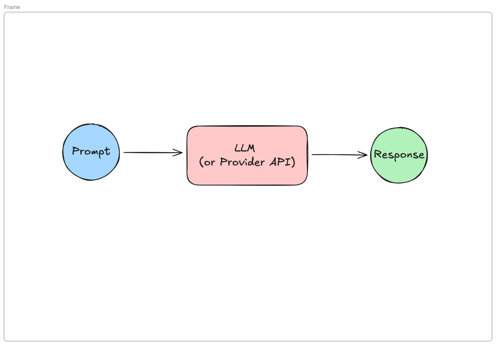

**Title:** What a Chatbot Actually Does, After 41 Chats in One Week
**Subtitle:** I counted every AI chat I started for seven days. Not one of them did anything outside the chat window, and that turned out to be the useful part.
**Published:** Tuesday 10 March 2026
**Where:** Slow Systems (edited by Dan)
**Read time:** 5 min

---

# What a Chatbot Actually Does, After 41 Chats in One Week

Last Tuesday at 7:40 in the evening, my partner was standing at the open fridge, phone in one hand, reading out what an AI chat app had suggested for dinner. "It says we've got leeks," they said. We did not have leeks. We have never, as a household, bought a leek.

The app had invented a fridge for us, and it sounded completely sure about it. That stuck with me on Biscuit's walk the next morning. I use these apps every day, and I realised I couldn't explain, in plain words, what happens between me pressing enter and the answer appearing.

So I paid attention for a week. I counted every chat I started from Monday to Sunday: 41 of them. Here's what I found, and it's simpler than I expected.

## One trip, every time

A plain chatbot does one thing. You send it text, it sends text back. That's the whole trip.

*Prompt in, response out. Everything a plain chatbot does happens inside that pink box.*

The circle on the left is your prompt: the message you typed, plus anything the app quietly adds, like the earlier messages in the same conversation. The pink box in the middle is the model, the LLM (short for large language model). "Provider API" is just the same box reached by another app instead of a chat window. When a note-taking app says it "has AI built in", it is usually sending your text to one of these boxes and showing you what comes back.

The circle on the right is the response. The model writes it a small chunk at a time, each chunk picked because it's a likely next piece given everything that came before. It isn't looking in your fridge. It's writing the most plausible answer to "what can I cook tonight?", and in a lot of kitchens, leeks are plausible.

I made the middle box pink because, in my diagrams, pink is the part to keep an eye on. That's where the confident guessing happens.

## A very well-read pen pal

The picture that finally made it click for me: a pen pal who lives in another city and has read an enormous amount. You write a letter, they write one back. The letters are often helpful and sometimes brilliant.

But they can't see your kitchen, check your calendar or ring the vet. They can only write back. And if you ask "what's in my fridge?", a polite pen pal who never says "I don't know" will describe a fridge that sounds about right.

Once I saw it that way, my 41 chats sorted themselves into two piles. 29 were writing jobs: tighten this paragraph, give me five headline options, explain this term. The pen pal is great at those. The other 12 were things I wanted done in the real world: check something, book something, remind me. For those 12, the best it could do was write me instructions, and then I did the doing.

## What went well

The writing jobs, mostly. Rewriting a clumsy intro took about 3 minutes, against my usual 15 of staring at it. Turning a long email of Dan's notes into a short list took under a minute, and it got 5 of his 6 points right (it merged two into one).

Explaining things went well too, with a catch. When I asked about a term I half-knew, I could spot the moment it drifted. When I asked about something I knew nothing about, I had no way to tell a good answer from a fluent one.

## What didn't work

All 12 of the "do something" chats. On Thursday I asked whether my 8:12 train was running. I got a cheerful answer with a platform number. The train was cancelled. It hadn't checked anything; it had written what a train-times answer usually looks like.

I also kept expecting it to remember me. On Wednesday I opened a new chat and typed "same tone as yesterday, please". It had no idea what yesterday was. Inside one conversation, the app sends the earlier messages back in with every new prompt, which is why it seems to remember. Start a fresh chat and that pile is gone. Some apps add a memory feature on top, but the box in the middle still only sees what's sent in on that one trip.

And I lost about 25 minutes over the week arguing with it. When an answer was wrong, I'd say so, it would apologise, and it would give me a new answer that was wrong in a different way. It was trying. It still couldn't see the fridge.

## Why this matters before anyone says "agent"

Most of the people I follow are talking about AI agents right now, and I'll get to them. But I couldn't understand what an agent adds until I was clear on what a plain chatbot leaves out. It doesn't act. It doesn't check. It doesn't loop back and try again on its own. It makes one trip from prompt to response and stops.

That isn't a flaw, exactly. For 29 of my 41 chats it was the right tool, and it was fast. The trouble only starts when I ask the pen pal to do a job that needs hands.

## Try this week

Pick one day and tally your AI chats in two columns: "write or explain something" and "do or check something in the real world". Don't change how you use it, just count. At the end of the day, look at the second column. Those are the chats where it was guessing, and the answers you should check before you act on them.

Mine was 29 to 12 for the week. Four of the 12 were train times, which says more about my commute than about the AI.
