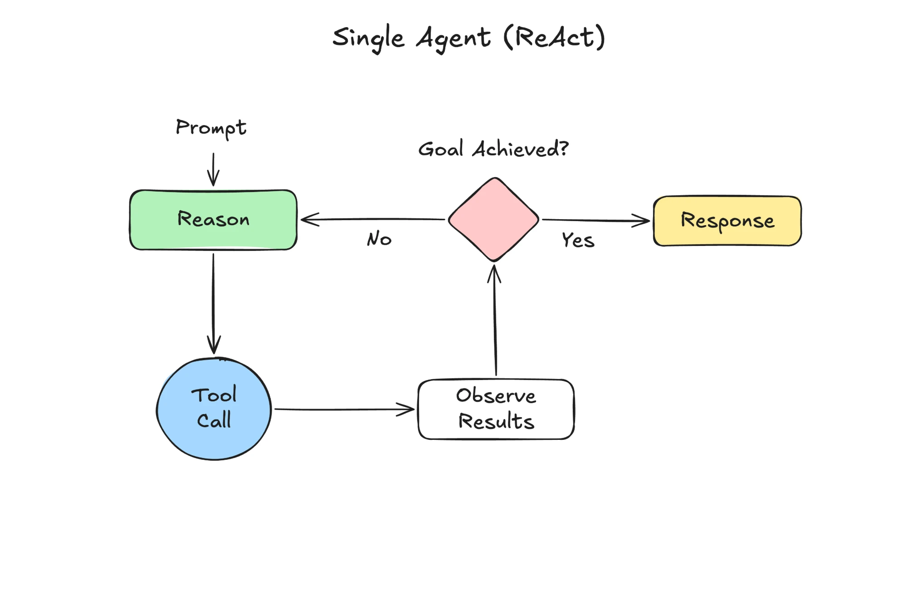

**Title:** The Loop Behind Every AI Agent, Explained With My Saturday Grocery Run
**Subtitle:** Reason, act, check, repeat. I watched an AI go round that loop 7 times to answer one question, and it's exactly what I do in the supermarket.
**Published:** Friday 15 May 2026
**Where:** Slow Systems (edited by Dan)
**Read time:** 5 min

---

# The Loop Behind Every AI Agent, Explained With My Saturday Grocery Run

Last Saturday at 9:15 I was standing in the fruit aisle of the shop on our corner, looking at an empty crate where the limes should have been. Biscuit was tied up outside with my partner, doing his best impression of a dog who has never been fed. The list on my phone said "2 limes (Thursday curry)".

I didn't stand there forever. I thought for a second, decided lemons would do, picked up two, checked the list again, and moved on. The whole shop took 26 minutes and three swaps like that.

On the walk home it hit me that I'd just done the thing every AI agent does. I'd been trying to explain it in a draft all week, badly. The supermarket explains it better.

## The loop

In March I wrote about plain chatbots: you send a prompt, the model sends a response, one trip, done. An agent is what you get when you give the model a way to do things and let it go round more than once.

*The loop: think, do one thing, look at what happened, decide whether you're done.*

The name you'll see for this is ReAct, short for "reason and act". Here's the loop in plain words, with my Saturday next to it.

**Prompt.** The job. Mine was "get everything for this week's dinners".

**Reason (green).** The model thinks about what to do next. Me: "Limes first, they're for Thursday."

**Tool call (blue).** It does one thing using a tool: a web search, a calendar, a calculator, a file. Me: walking to the fruit aisle.

**Observe results.** It looks at what came back. Me: an empty crate.

**Goal achieved? (pink).** It asks whether the job is done. If no, back to Reason with what it just learned. Me: "No limes. Lemons will do." Round again. If yes, it writes the **Response (yellow)** and stops. Me: the checkout.

That's it. The difference between a chatbot and an agent isn't a cleverer brain in the middle. It's the arrow that goes back.

The important word is "one". The agent doesn't plan the whole shop in advance and then march through it with its eyes shut. It takes one step, looks, and lets what it saw change the next step. If I'd planned my route around limes being there, I'd have been stuck. Because I looked, the empty crate just became new information.

## Watching it go round

To see the loop for real, I gave an AI chat app with web search switched on a job I'd normally do myself: find a pub within a 20-minute walk of us that allows dogs, does Sunday lunch, and has outdoor tables.

The app shows its steps if you expand them, so I counted. It went round 7 times in 2 minutes and 40 seconds. It searched for pubs near our area, read a list, searched one name plus "dog friendly", found a menu page, noticed the menu didn't mention Sunday, searched again, and so on. Each time, it changed its next move based on what the last one turned up.

That's the bit a plain chatbot can't do. In March, my chat app told me my train was running when it was cancelled, because it never looked. This time it looked, saw something, and adjusted. It came back with two pubs. We went to one on Sunday, and Biscuit got a sausage he did not deserve.

I ran four tests like this during the week. Two came back with answers I'd trust. One, checking which of my saved articles mentioned time blocking, was fine but slower than searching my own folder. One was a mess, which brings me to the next part.

## What didn't work

The loop only stops when the model decides the goal is achieved, and it doesn't always decide well. In the pub test, it said one place had outdoor tables based on a review from 2021. The pink diamond said yes. I'd have said "check something newer".

It can also go round too many times. My fourth test was vague, "find me a good notebook for planning", and it looped 11 times, comparing things I didn't care about, before giving me a long answer that didn't pick anything. In the supermarket I'd have known what "good" meant. It didn't, because I never told it.

And it's slower. The pub search took 2 minutes 40 seconds; a plain chatbot answers in about 10 seconds. That's fine when the answer needs checking. It's silly for "rewrite this sentence", where there's nothing to look up and the loop just adds waiting.

I also caught myself not reading the steps. By test three I was making tea while it looped and only reading the final answer. That's exactly when the 2021 review slips through. The loop checks its own work, but only against what it decided "done" means.

## The part I keep coming back to

Every agent I've read about since, however fancy the diagram, has this loop somewhere inside it. Think, do one thing, look, decide. Some have more tools, some have several loops talking to each other. But if you can picture yourself in the fruit aisle swapping limes for lemons, you understand the core of it.

The other thing I keep coming back to: the diamond only works if it knows what "done" looks like. I knew my shop was done when everything on the list was in the basket. My notebook prompt had no list.

## Try this week

Next time you give an AI app a job that involves looking things up, add one sentence that says what "done" looks like. "Done means two options, each with a link from this year." Then expand the steps, if your app shows them, and count how many times it goes round.

My notebook prompt went from 11 loops to 4 when I did that. I bought the second one it suggested.
