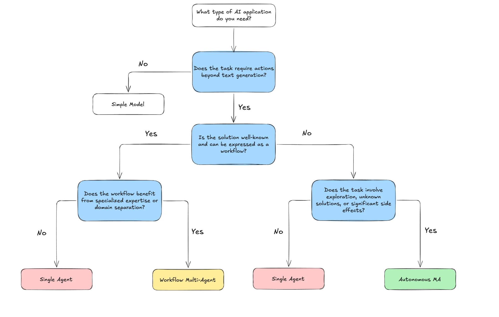

**Title:** I Built Five AI Agents in June. I Needed One.
**Subtitle:** The four-question flowchart I now walk through before building anything, and the box I should have stopped at three times.
**Published:** Tuesday 7 July 2026
**Where:** Slow Systems (edited by Dan)
**Read time:** 6 min

---

# I Built Five AI Agents in June. I Needed One.

On the last Sunday of June I sat on the back step with a coffee while Biscuit dug a hole in the one patch of lawn we'd reseeded. I had my laptop on my knees, and in 11 minutes I deleted three AI agents I'd spent most of the month building.

It wasn't dramatic. They worked, more or less. They just did jobs that didn't need an agent at all, and I'd only noticed because I tried to explain one of them to my partner and couldn't say why it existed.

After the grocery-loop piece in May, I got excited. If an agent is a model that can reason, use a tool, check, and go round again, surely everything I do could use one. So in June I built five. I spent about 14 hours on them, mostly in the evenings. Here's the flowchart I wish I'd drawn first.

## Four questions, top to bottom

*Four questions. Most of my June ended at the first one.*

You start at the top and answer each blue box honestly. Here's what each one means in plain words.

**1. Does the task need actions beyond writing text?** Does it have to search, open a file, check a calendar, send something? If not, you want a **simple model**: a normal chat app, maybe with a saved prompt. No loop, no tools.

**2. Is the solution well known, and can you write it as steps?** If you could write the job as a recipe ("take the transcripts, tag each one, put it in this table"), go left. If you don't know the steps in advance and it has to work them out, go right.

**3. (Left side) Does it help to split the work between specialists?** Would separate helpers with separate jobs do better than one? If no, a **single agent** is enough. If yes, a **workflow multi-agent** setup: several agents, each with one job, passing work along a fixed route.

**4. (Right side) Does it involve exploring, unknown answers, or big side effects?** Side effects means things that change the real world: sending emails, deleting files, spending money. If no, a **single agent** again. If yes, the bottom-right box, **autonomous multi-agent**, where several agents decide their own steps. That's the box where you'd want the most care, not the least.

The analogy I use now is a kitchen. A simple model is the toaster. A single agent is one cook who can open the fridge and taste as they go. A workflow multi-agent is a kitchen line with stations and a fixed menu. Autonomous multi-agent is handing a team "cater a wedding" with no menu and the keys to your car.

I'd been hiring a catering team to make toast.

## Where my five landed

**The headline agent.** It searched for similar titles before suggesting mine. Took 3 hours to build. When I put it through question 1, the search wasn't adding anything; a saved prompt in a chat app gave me the same headline options in about 40 seconds. Simple model. Deleted.

**The Dan-notes summariser.** It read his email and wrote a checklist. I'd given it a "tool" that saved the result to Notion, but I can paste. Question 1 again: no. Simple model. Deleted.

**The research-to-outline team.** Three agents: one researched, one outlined, one critiqued the outline. It went through question 2 (yes, I know the steps) and stalled at question 3. Did splitting it help? Honestly, the critic mostly repeated the outliner. One agent with the same instructions did as well in half the time. Single agent. Rebuilt as one, then deleted that too, because I prefer doing my own outlines.

**The voice memo sorter.** This one stayed. It reads the transcripts from my morning walks, tags each memo with a topic, and adds a line to my idea list. It needs a tool (it reads files), the steps are well known, and one agent is enough. Single agent, left side. It saves me about 20 minutes a week, and it found an idea from April I'd completely forgotten.

**The "do my Monday" agent.** It was meant to pick ideas, draft outlines and put them on my calendar by itself. That's the far right of the chart: exploring, unknown answers, and side effects on my actual calendar. I abandoned it after it booked a "writing block" over Biscuit's vet appointment. I'll come back to planning later in the year, more carefully.

## What didn't work

The flowchart itself fooled me at first. Question 1 asks about "actions beyond text", and I counted everything as an action. Saving to Notion felt like an action. Copying a result into a doc felt like an action. By that logic everything needs an agent. The honest test is: would it be a real loss if I did that one step myself? For two of my five, it wouldn't.

The bigger problem was that building is fun. Every evening I'd sit down meaning to write and end up wiring a new tool into something. 14 hours in a month is roughly three articles I didn't write. The flowchart doesn't help with that part. Only noticing does.

## Try this week

Take one AI thing you've built, or one you're planning to build, and ask yourself question 1 only: does this need to do something beyond writing text, and would it be a real loss if I did that one step myself?

If the answer is no, try the same job with a saved prompt in a normal chat app and time it. My headline agent lost to a saved prompt by about 2 hours and 59 minutes.
