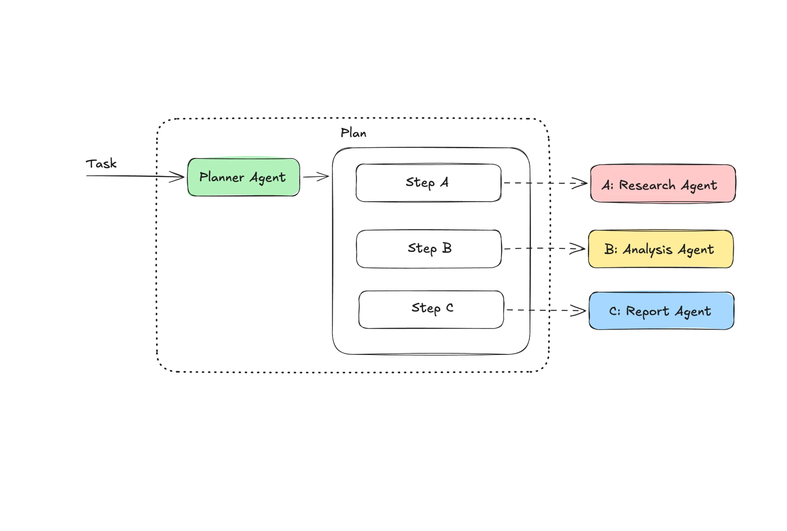

**Title:** I Let One AI Plan My Week
**Subtitle:** A planner AI split my Monday idea-picking into three jobs and handed each one to a helper. It worked 3 Mondays out of 4.
**Published:** Tuesday 22 September 2026
**Where:** Slow Systems (edited by Dan)
**Read time:** 6 min

---

# I Let One AI Plan My Week

Last Monday at 8:05 I came back from walking Biscuit, made a coffee, and opened a one-page brief that was waiting for me. Three article ideas, a reason for each, a rough outline for the first. I read it on the sofa with wet dog smell drifting in from the hall, and I'd picked my week by 8:20.

That's normally the worst hour of my week. On Mondays I go through my idea list and pick what to write, and I second-guess everything. It usually takes me about 60 minutes, sometimes more.

For four Sundays in a row I gave that job to a planner AI before bed. To be clear about the headline: it planned my writing week, not my whole life. The dentist and Biscuit's flea treatment still lived in my head. But the bit that eats my Monday, it took.

## One planner, three helpers

In July I wrote about building five agents and needing one. I still think most jobs need less than people build. But my Monday job really does split into separate parts, and that's exactly what a planner setup is for.

*The planner turns one task into three steps, then hands each step to a helper that only does that one thing.*

Here's what each box did for me.

**Task.** One sentence on Sunday night: "Plan my writing week: find my best three ideas and outline the first."

**Planner agent (green).** It doesn't do the work. It reads the task and writes a plan: a short list of steps. Most weeks its plan was the same three steps, which is what I wanted.

**The dotted box.** The planner and its plan belong together. I drew them in one group because the plan is the planner's only output. Everything to the right of the dotted line is somebody else's job.

**Step A to the research agent (pink).** It reads the week's voice memo transcripts from my morning walks, my idea list, and the comments on my last few pieces. It pulls out anything that looks like an article idea. I made it pink because it's the risky one: it's the only helper reading raw material, so its mistakes flow into everything after it.

**Step B to the analysis agent (yellow).** It scores those ideas against my own rules. Can I try it this week? Is it one idea, no "and also"? Would a team lead on the train care? Have I written something too close to it recently?

**Step C to the report agent (blue).** It writes the one-page brief I read on Monday morning.

The dashed arrows are handoffs. Each helper gets only its step and only what it needs, not the whole pile.

## The kitchen version

When my partner and I cook for friends, one of us reads the recipe out and hands out jobs. You chop, I do the sauce, someone sets the table. The person reading the recipe doesn't chop anything. That's the planner.

It works because each job is small and clear. Nobody chopping onions has to think about the dessert. It falls apart when the person reading the recipe misreads it, which brings me to what went wrong.

## What didn't work

Week 2, the planner wrote a different plan. Instead of "research my memos", Step A became "research competitor articles on the topic". The research agent did exactly what it was told and came back with 31 links, about 9 of them useful, none of them mine. The brief that Monday was a summary of other people's ideas. I spent 50 minutes redoing it by hand, so that week was no faster than usual.

The research agent also got a memo wrong. I'd recorded one memo about a meeting-notes template and another, two days later, about Dan's feedback. It merged them into one idea that didn't exist. I only caught it because I remembered the walk.

And the report agent's first brief was 1,400 words. A one-page brief should be one page. I added "under 300 words" to its instructions and it behaved after that.

Also, it isn't free in time. Setting it up took me about 3 hours across two evenings, and each Sunday I spent 5 minutes checking the plan before letting it run.

## The numbers

Across four Mondays, picking my week took 15, 50, 12 and 14 minutes. Against my usual hour, that's 3 good Mondays out of 4 and about 2.5 hours saved, which almost pays back the 3 hours of setup. October should be the first month it's actually ahead.

The research agent read 23 voice memos in total. It surfaced 4 ideas I'd recorded and forgotten. One of those became my next Slow Systems piece.

## What I'd tell a team lead

If your recurring job has clear parts that need different kinds of attention (find things, judge things, write it up), a planner with helpers can take it off your plate. Check the plan before it runs, because if the planner misreads the task, every helper does the wrong job very efficiently.

If your job is one part, don't bother. A single prompt will do.

## Try this week

Take the task that eats your Monday and write it down as three steps: find, judge, write up. Don't build anything. Just see whether it actually splits into three. Mine did. If yours doesn't, you've saved yourself 3 hours of setup.
