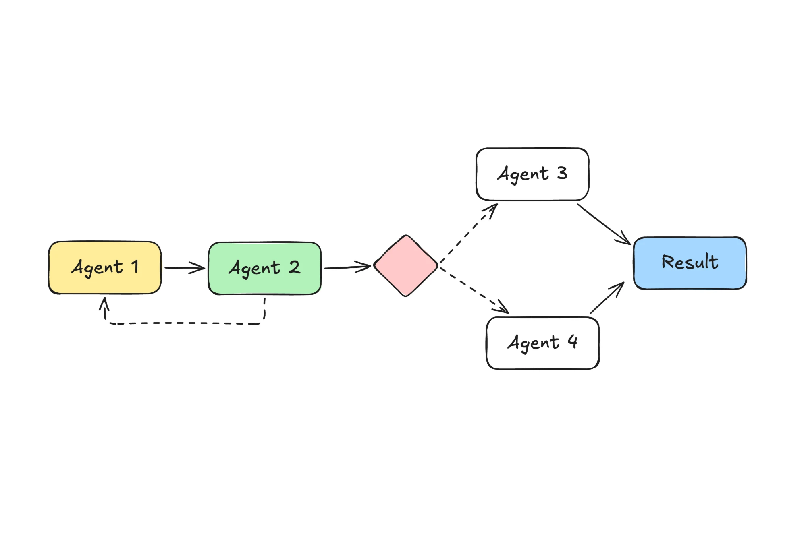

**Title:** I Chained Four AIs to Write My Newsletter. Two of Them Were Pointless.
**Subtitle:** Three Sundays, one chain, and the 25 minutes a week I got back by deleting half of it.
**Published:** Friday 16 October 2026
**Where:** Slow Systems (edited by Dan)
**Read time:** 6 min

---

# I Chained Four AIs to Write My Newsletter. Two of Them Were Pointless.

On Sunday 5 October, at ten past eight in the evening, I was on the sofa with Biscuit snoring at the other end, reading the newsletter my AI chain had just written. It opened with "Dear valued subscribers!" There are about 900 of you, and not one of you has ever been called valued by me.

That was the third Sunday I'd run the chain. It was also the Sunday I opened the setup and started deleting.

My newsletter is small and plain: what I published that week, one thing I'm testing, one link I liked. It normally takes me about 70 minutes on a Sunday evening, most of it spent scrolling back through my own week trying to remember what happened. I wanted it to take 20. So I built a chain of four AIs, each doing one part, passing the work along like a relay.

It took two evenings to set up, about 4 hours in all. I ran it on 21 September, 28 September and 5 October, and kept a note each time of how long the chain ran and how long I spent fixing what came out.

## The chain

*Four AIs in a row, with one loop back and one fork. The fork is the part I deleted.*

Here's what each box did.

**Agent 1, the gatherer (yellow).** It collected my raw material for the week: the two articles I'd published, the voice memo transcripts from my morning walks, and the links I'd saved. It turned all that into a page of notes.

**Agent 2, the drafter (green).** It wrote the newsletter from those notes. If the notes were too thin, it sent them back to Agent 1 and asked for more. That's the dashed arrow looping back. It happened on 2 of the 3 Sundays, both times because I'd only saved one link that week.

**The diamond (pink).** A check: is the draft over 600 words? Pink because this is where the chain makes a decision without me.

**Agent 3, the trimmer.** If the draft was long, it cut it down.

**Agent 4, the polisher.** If the draft was short enough, it "made it sound friendly and engaging". I wrote that instruction. I regret it.

**Result (blue).** The finished newsletter, ready for me to read and send.

## Four cooks, one soup

The first two agents earned their place. Gathering is a different job from writing, and keeping them apart meant the drafter only saw tidy notes, not 14 rambling memo transcripts. The loop back was useful too: on thin weeks, the drafter asking for more beat the drafter making things up.

The last two were four cooks salting the same soup. Agent 2 had already written something close to my voice. Then Agent 3 or Agent 4 took a turn, and each one nudged it a bit further from me. By the time it reached the Result box it was someone else's soup.

This is the thing nobody tells you about chains. Each agent only sees what the one before it handed over, not what you originally wanted. Agent 4 never saw my past issues or my voice memos. It saw a finished draft and an instruction to make it "engaging", and it did its honest best with that. A relay is only as good as its worst handover.

## What didn't work

The trimmer cut the wrong things. On the first Sunday, the draft was 740 words. The trimmer took it to 580 by removing every specific number and the one joke. "My meeting notes went from 40 minutes to 10" became "my meeting notes got much faster". That's the exact sentence Dan would circle in red.

The polisher was worse. On the other two Sundays, the draft came in under 600 words, so it went to Agent 4. It added exclamation marks (11 in one issue), a "Dear valued subscribers", and a sign-off I'd never write. I spent most of my editing time taking out what Agent 4 had put in.

So the numbers didn't move the way I wanted. The chain ran for about 11 minutes each Sunday, and I spent 40 to 45 minutes fixing the result. That's roughly 55 minutes against my usual 70. Better, but not by much, and I liked the result less.

The other thing that didn't work: I couldn't tell where a problem came from. When a sentence was wrong, I had to read four sets of output to find which agent had broken it. With two agents, there are only two places to look.

## Cutting it in half

On 12 October I deleted Agents 3 and 4, and the diamond with them. I added two lines to Agent 2's instructions instead: "Under 600 words. Keep every number and sound like the three past issues pasted below."

That one change did both jobs the deleted agents were meant to do. The chain now runs in about 5 minutes. I spent 20 minutes editing that Sunday, and 25 the one after. Call it 25 to 30 minutes in total, down from 70.

When I ran it past my partner over dinner, they asked why I'd built the trimmer and the polisher in the first place. Honest answer: the diagram looked more finished with a fork in it. That's not a reason.

The lesson I keep relearning since July is the same one. Each extra agent is another hand on your work. If its job can be one sentence in an earlier agent's instructions, it should be.

## Try this week

If you have a chain of AIs doing something for you, switch off the last step for one run and compare the output with and without it. Don't rebuild anything. Just read both versions side by side.

If you can't tell which one had the extra step, you've found an agent to delete. I found two.
